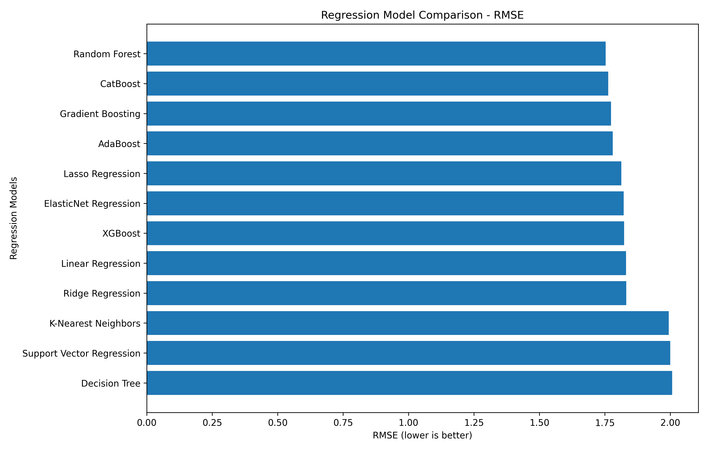
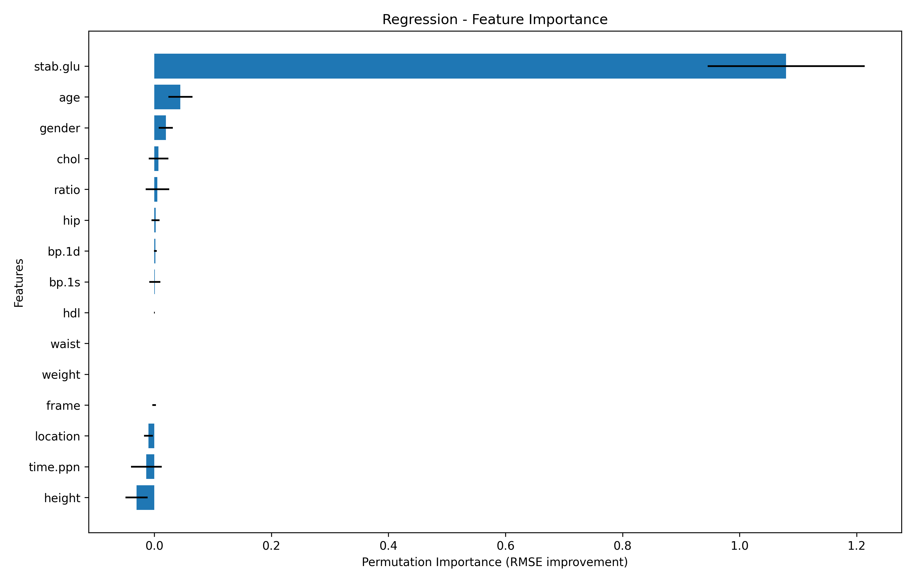
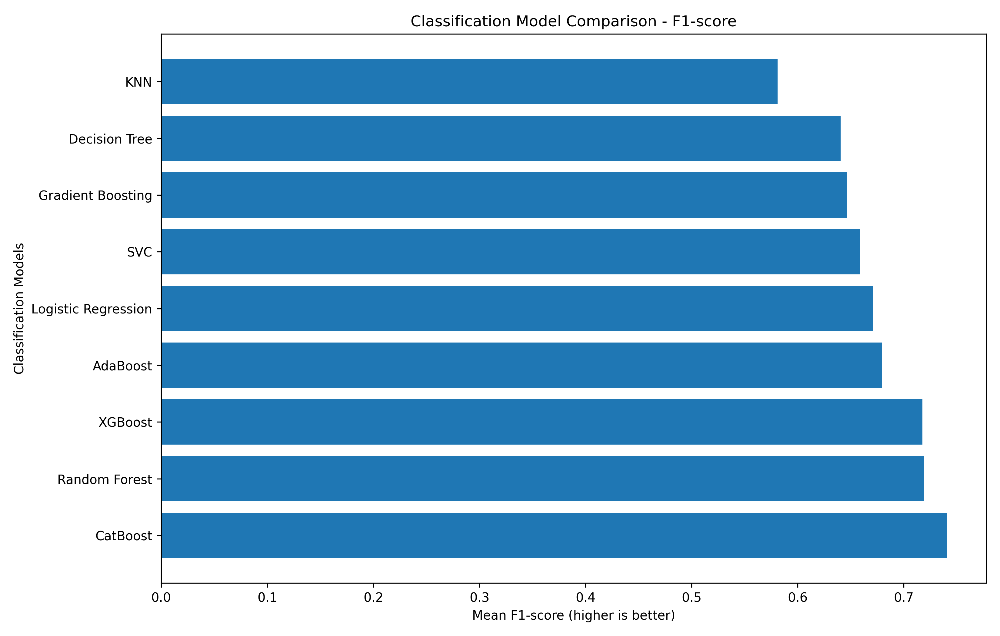
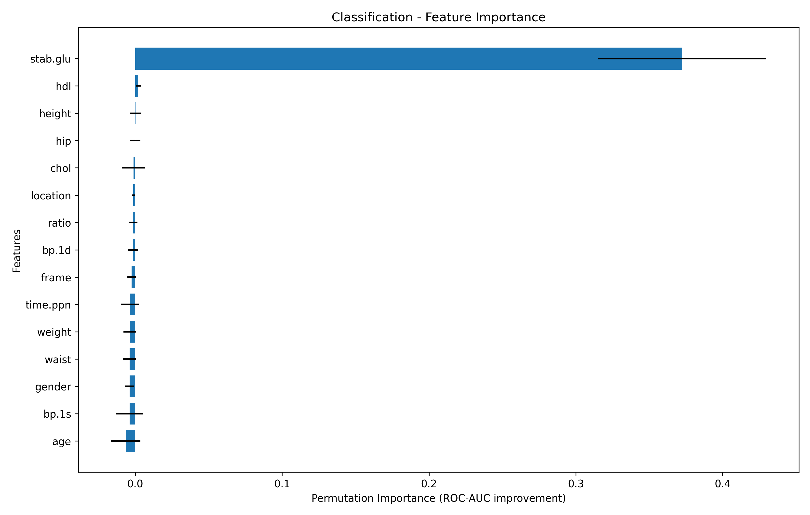

# Diabetes Prediction Using Machine Learning Algorithms

A machine learning research project comparing regression and classification algorithms to predict Glycosylated Hemoglobin (GlyHb) values and a GlyHb-derived diabetes-related category.

## Project Overview

This research compares multiple machine learning algorithms to investigate two prediction tasks:

- **Regression:** Predicting GlyHb concentration percentages.
- **Classification:** Predicting a diabetes-related category derived from GlyHb values.

The original dataset contained 403 records and 19 variables. After preprocessing, 390 records and 15 predictor features were used.

### Key Results

| Task           | Selected Model   | Main Test Result  |
| -------------- | ---------------- | ----------------- |
| Regression     | Lasso Regression | R² = 0.5073       |
| Classification | CatBoost         | Accuracy = 89.74% |
| Classification | CatBoost         | F1 Score = 71.43% |

**Main finding:** Stabilized glucose (`stab.glu`) was the strongest predictive feature in both experiments.

> **Important:** The classification target was created using a project-defined GlyHb threshold of 7.0%. It is not an independently recorded clinical diagnosis. This project is for research and educational purposes, not medical diagnosis.

---

## Project Structure

```text
diabetes_preprocessing/
│
├── data/
│   ├── diabetes.csv
│   ├── diabetes_cleaned.csv
│   ├── features.csv
│   ├── target.csv
│   └── ... processed datasets and model results
│
├── results/
│   └── figures/
│       ├── regression_model_comparison.png
│       ├── classification_model_comparison.png
│       ├── regression_feature_importance.png
│       └── classification_feature_importance.png
│
├── src/
│   ├── preprocessing.py
│   ├── model_training.py
│   ├── model_validation.py
│   ├── final_evaluation.py
│   ├── feature_importance.py
│   ├── classification_preprocessing.py
│   ├── classification_training.py
│   ├── classification_validation.py
│   ├── classification_final_evaluation.py
│   ├── classification_feature_importance.py
│   └── visualizations.py
│
├── README.md
├── requirements.txt
└── .gitignore
```

## 1. Dataset Description

The dataset was obtained from:

[Diabetes Dataset – H. Biostat](https://hbiostat.org/data/repo/diabetes.csv)

Original dataset information:

- Records: 403
- Variables: 19
- Target variable for regression: `glyhb`
- Data types: Numerical and categorical

Some of the available variables include:

- Age
- Gender
- Cholesterol
- Stabilized glucose
- Height and weight
- Blood pressure
- Waist and hip measurements

After removing records with missing GlyHb values and excluding two blood pressure columns with excessive missing values (`bp.2s` and `bp.2d`), 390 records remained. The `id` column was excluded because it is an identifier, not a predictive feature.

## 2. Data Preprocessing

The following preprocessing steps were applied:

1. Loaded the dataset using Pandas.
2. Removed records with missing GlyHb target values.
3. Removed blood pressure columns with excessive missing values.
4. Used median imputation for missing numerical values.
5. Used most-frequent imputation for missing categorical values.
6. Applied StandardScaler to numerical features.
7. Applied OneHotEncoder to categorical features.
8. Split the dataset into 80% training data and 20% testing data.

Preprocessing transformations were fitted using training data only and then applied to testing data to prevent data leakage.

Final dataset:

| Description                        | Records |
| ---------------------------------- | ------: |
| Total cleaned records              |     390 |
| Training records                   |     312 |
| Testing records                    |      78 |
| Predictor features before encoding |      15 |

## 3. Regression Analysis

### 3.1 Models Compared

Twelve regression algorithms were trained and compared:

1. Linear Regression
2. Lasso Regression
3. Ridge Regression
4. ElasticNet Regression
5. K-Nearest Neighbors
6. Decision Tree
7. Random Forest
8. XGBoost
9. CatBoost
10. AdaBoost
11. Gradient Boosting
12. Support Vector Regression

### 3.2 Model Validation

Five-fold cross-validation was used to compare the models.

Lasso Regression achieved the lowest mean cross-validation RMSE of **1.4054** and the highest mean cross-validation R² of **0.5426**.

Therefore, Lasso Regression was selected as the final regression model.

### 3.3 Regression Model Comparison

The following chart compares the models using their initial test-set RMSE. Lower RMSE indicates better prediction performance.



### 3.4 Final Regression Evaluation

| Evaluation Metric | Result |
| ----------------- | -----: |
| MAE               | 1.0148 |
| MSE               | 3.2851 |
| RMSE              | 1.8125 |
| R²                | 0.5073 |

The R² score indicates that the model explains approximately 50.73% of the variation in GlyHb values in the test dataset.

### 3.5 Regression Feature Importance

Permutation importance was used to investigate how much each feature contributed to the model's predictive performance.



Stabilized glucose (`stab.glu`) was the strongest predictive feature, with an importance score of 1.079570.

## 4. Classification Analysis

### 4.1 Classification Target Creation

The original dataset did not contain a separate diabetes diagnosis column. Therefore, a binary classification target was created using this project-defined rule:

```python
y_class = (glyhb > 7.0).astype(int)
```

- Class 0: GlyHb less than or equal to 7.0%.
- Class 1: GlyHb greater than 7.0%.

Class distribution:

| Category              | Records | Percentage |
| --------------------- | ------: | ---------: |
| Negative category (0) |     330 |     84.62% |
| Positive category (1) |      60 |     15.38% |
| Total                 |     390 |       100% |

The dataset was imbalanced, so stratified splitting and class-balancing techniques were used.

### 4.2 Classification Models Compared

Nine classification algorithms were trained:

1. Logistic Regression
2. K-Nearest Neighbors
3. Decision Tree
4. Random Forest
5. XGBoost
6. CatBoost
7. AdaBoost
8. Gradient Boosting
9. Support Vector Classifier

### 4.3 Model Validation

Five-fold stratified cross-validation was performed using F1 score, recall, precision, and ROC-AUC.

CatBoost achieved the highest mean F1 score (0.7409) and recall (0.8167). Random Forest achieved a slightly higher mean ROC-AUC (0.9277).

CatBoost was selected based on its overall F1 and recall performance.

### 4.4 Classification Model Comparison

The chart compares classification algorithms using their mean cross-validation F1 scores. Higher values indicate better F1 performance.



### 4.5 Final Classification Evaluation

The selected CatBoost model was evaluated on the independent test dataset.

| Evaluation Metric | Result |
| ----------------- | -----: |
| Accuracy          | 89.74% |
| Precision         | 62.50% |
| Recall            | 83.33% |
| F1 Score          | 71.43% |
| ROC-AUC           | 93.69% |

The model correctly classified 70 out of 78 test records.

### 4.6 Confusion Matrix

| Actual / Predicted | Negative | Positive |
| ------------------ | -------: | -------: |
| Actual Negative    |       60 |        6 |
| Actual Positive    |        2 |       10 |

The model correctly identified 60 negative records and 10 positive records. It incorrectly classified 6 negative records as positive and missed 2 positive records.

### 4.7 Classification Feature Importance



Stabilized glucose was the strongest predictive feature, with an importance score of 0.372433. Most other features had importance values close to zero or slightly negative on the test dataset.

## 5. Discussion

The experiments identified stabilized glucose as the strongest predictive feature in both regression and classification.

- **Regression:** Lasso Regression was selected based on cross-validation performance, with a test R² of 0.5073.
- **Classification:** CatBoost achieved a mean cross-validation F1 score of 0.7409 and a test accuracy of 89.74%.

Accuracy alone is not sufficient for evaluating models on imbalanced datasets. Precision, recall, F1 score, and ROC-AUC provide additional information about classification performance.

These findings describe predictive relationships within this dataset. They do not establish that any feature causes diabetes.

## 6. Limitations

This research has several limitations:

1. The original dataset contains only 403 records.
2. The classification target was derived from GlyHb rather than obtained from an independently recorded diabetes diagnosis.
3. The classification dataset is imbalanced.
4. Some variables contained many missing values and had to be excluded.
5. Model results may vary with different train-test splits.
6. Feature importance identifies predictive contribution, not medical causation.

Therefore, these models should be considered research experiments rather than clinical diagnostic systems.

## 7. Technologies Used

- Python
- Pandas
- NumPy
- Scikit-learn
- Matplotlib
- XGBoost
- CatBoost
- Git and GitHub
- Visual Studio Code

## 8. Installation and Usage

### Requirements

Python 3.13 or a compatible Python version is recommended.

### Step 1: Clone the repository

```bash
git clone https://github.com/mhirrt12/MachineLearningReaserching.git
```

### Step 2: Enter the project folder

```bash
cd MachineLearningReaserching/diabetes_preprocessing
```

### Step 3: Create a virtual environment

```bash
python -m venv .venv
```

### Step 4: Activate the environment

Windows Git Bash:

```bash
source .venv/Scripts/activate
```

Windows PowerShell:

```powershell
.venv\Scripts\Activate.ps1
```

### Step 5: Install dependencies

```bash
pip install -r requirements.txt
```

### Step 6: Generate visualizations

From the `diabetes_preprocessing` folder, run:

```bash
python src/visualizations.py
```

The charts will be saved in:

```text
results/figures/
```

Other scripts in `src/` perform preprocessing, training, validation, and model evaluation. Run them from the project folder so their relative data paths resolve correctly.

## 9. Conclusion

This research compared multiple machine learning algorithms for predicting GlyHb percentages and a GlyHb-derived diabetes-related category.

Lasso Regression was selected for regression, achieving an R² score of 0.5073 and RMSE of 1.8125.

CatBoost was selected for classification, achieving 89.74% accuracy, 71.43% F1 score, and 93.69% ROC-AUC on the test dataset.

Stabilized glucose was identified as the strongest predictive feature in both tasks.

Further research using larger datasets and independently confirmed diabetes diagnoses is necessary before making clinical conclusions.

## 10. References

1. [Diabetes Dataset – H. Biostat](https://hbiostat.org/data/repo/diabetes.csv)
2. [Scikit-learn Documentation](https://scikit-learn.org/stable/)
3. [XGBoost Documentation](https://xgboost.readthedocs.io/)
4. [CatBoost Documentation](https://catboost.ai/docs/)
5. [Pandas Documentation](https://pandas.pydata.org/docs/)

---

**Project Repository:** [MachineLearningReaserching](https://github.com/mhirrt12/MachineLearningReaserching)